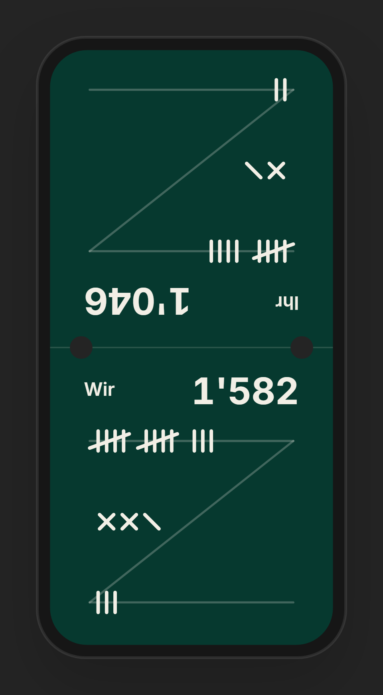

# YS-Jasstafel

Mobile PWA zum Punkteschreiben beim Schieber. Next.js 16 (App Router) · Supabase · Cloudflare Workers (OpenNext).

<p align="center">
  
</p>

## Setup

1. **Supabase**: `supabase/init.sql` im SQL-Editor ausführen (komplettes Setup, mehrfach ausführbar).
   - Auth → Providers: E-Mail und Google aktivieren.
   - Auth → URL Configuration: Site URL setzen und `https://<domain>/auth/callback` (plus `http://localhost:3000/auth/callback`) als Redirect-URL eintragen.
2. **Env** (`.env.local`, wird beim Build ins Browser-Bundle übernommen):
   ```
   NEXT_PUBLIC_SUPABASE_URL=…
   NEXT_PUBLIC_SUPABASE_ANON_KEY=…
   ```
   Ohne diese Variablen läuft die App rein lokal (localStorage, kein Login).
3. **Worker-Secrets** (für den Heartbeat-Cron):
   ```
   npx wrangler secret put SUPABASE_URL
   npx wrangler secret put SUPABASE_SERVICE_ROLE_KEY
   ```

## Befehle

```
npm run dev       # localhost:3000
npm run build     # next build
npm run lint
npm run preview   # OpenNext-Build + lokaler Worker
npm run deploy    # OpenNext-Build + Deploy
npm run icons     # PWA-Icons neu generieren
```

## Aufbau

- `app/page.tsx` – Landing Page; wer die App schon benutzt hat, wird direkt zur letzten Tafel weitergeleitet (`/?info` zeigt sie trotzdem)
- `app/spiele` – Spiele-Menü · `app/spiel?id=…` – Tafel · `app/login`, `app/registrieren` – Auth (Session bleibt gespeichert)
- `lib/scoring.ts` – Rundenberechnung (`Eingabe × m` / `(157 − Eingabe) × m`, Match `257 × m`), Totals, Sieger, Striche
- `lib/store.ts` – Spielstand: localStorage-Cache, mit Login zusätzlich Outbox → Supabase (offline-fähig); lokale Spiele werden beim ersten Login hochgeladen
- `components/Board.tsx` – Tafel: untere Hälfte Team A, obere Hälfte Team B (180° gedreht), Mittellinie mit Menü / Verlauf / Rückgängig
- `public/sw.js` – Service Worker (Seiten network-first, Assets cache-first)
- `worker.ts` – Custom Worker-Entry: OpenNext-`fetch` + `scheduled`-Handler (Cron `0 3 * * 1` schreibt/liest/löscht `heartbeat`)
